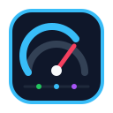

<div align="center">
  
  <h1>Antigravity Telemetry Monitor</h1>
  <p>
    <strong>Real-time Model Routing, Token/s Speed, KV Cache &amp; 5h/Weekly Quota Monitor for Google Antigravity IDE &amp; OpenAI Codex</strong>
  </p>
  <p>
    <strong>English</strong> | <a href="./README.zh-CN.md">简体中文</a>
  </p>
  <p>
    
    
    
  </p>
</div>

---

**Antigravity Telemetry Monitor** (`agy-telemetry`) is a lightweight, zero-dependency Antigravity IDE plugin & sidecar HUD. It gives you full real-time observability into what your AI coding agents are actually doing under the hood: which backend model responded, true streaming Token/s speed, TTFT latency, KV cache hit size & rate, per-turn token usage, 5-hour & weekly quota consumption, background commands, and OpenAI Codex synergy.

## ✨ Key Features

### 1. Real-Time Fleet & Recent Active Tasks
- **Recent Active View (`最近活跃`)**: Automatically surfaces all **in-progress** tasks (pinned at the top) plus **today's unarchived conversations**, without letting finished background subagents clutter your workspace.
- **Filter Tabs**: Quickly switch between `Recent Active`, `Codex`, and `All` sessions, with one-click jump back into any Antigravity conversation or Codex Desktop thread.
- **Background & Daemon Control**: Displays running background commands and daemon services inline with live elapsed timers, log tail viewer, command copy, and instant stop controls.

### 2. Per-Turn & Session-Average Speed & KV Cache
- **Current / Latest Turn vs. Session Average**:
  - **Streaming TPS**: `outputTokens / streamingDuration` — true generation speed excluding TTFT wait and buffered tool flushes.
  - **End-to-End (E2E) TPS**: `outputTokens / (TTFT + streamingDuration)` — overall turnaround throughput.
  - **KV Cache Hit Rate & Actual Size (`k`)**: Shows both hit percentage and exact cached read volume in `k` tokens (e.g., `94.5% (859.7k)`), for both the current/latest turn and the full conversation average.

### 3. Persistent Turn History & Independent 5h / Weekly Quota Tracking
- **Inline Accordion Drilldown**: Click any conversation card to expand its detail panel directly in place (single-open accordion) with preserved scroll state.
- **Per-Turn Task List**: Aggregates underlying LLM API calls by user prompt turn (`USER_INPUT` in Antigravity / `task_started` in Codex) and persists history locally to `telemetry_task_history.json`.
- **Full Token Breakdown**: Displays total tokens per turn (`uncached input + cache read + output`) with full `In / Cache / Out (Thinking / Response)` details, expandable down to individual LLM invocations.
- **5h & Weekly Quota Attribution**:
  - **Antigravity**: Combines `RetrieveUserQuotaSummary` and `GetCascadeModelConfigData` with a 4-second background sampler to capture 5h and weekly quota pool drops per turn (proportionally attributed by token delta with a `~` indicator when multiple tasks share a pool concurrently).
  - **Codex**: Automatically parses native `rate_limits` snapshots from Codex rollout JSONL logs to backfill per-turn 5h and weekly quota usage.

### 4. Model Routing, Fingerprints & Degradation Diagnostics
- **Route Mismatch Detection**: Compares requested model tier against `responseModel` and `executionModel`.
- **Thinking Signature Header Ledger**: Decodes thinking signature protocol headers locally and alerts on unexpected key/protocol changes (`telemetry_fingerprints.json`).
- **Retry & Latency Diagnostics**: Distinguishes real upstream `429` rate-limit retries from local proxy/EOF reconnects, flags pure queue latency, CoT collapse, and long-context cache shocks.

### 5. OpenAI Codex Desktop / CLI Synergy
- Reads local `~/.codex` SQLite state and rollout JSONL streams to track standalone Codex threads as well as Antigravity conversations delegating work to Codex.

---

## 📦 Installation

### Prerequisites
- **Google Antigravity IDE**
- **Node.js `>= 22.0.0`** (required for built-in `node:sqlite`)

### Install from GitHub

Clone this repository directly into your Antigravity plugins directory as `agy-telemetry`:

**macOS / Linux:**
```bash
git clone https://github.com/sLokya/antigravity-telemetry-monitor.git ~/.gemini/config/plugins/agy-telemetry
```

**Windows (PowerShell):**
```powershell
git clone https://github.com/sLokya/antigravity-telemetry-monitor.git "$env:USERPROFILE\.gemini\config\plugins\agy-telemetry"
```

Then enable **Antigravity Telemetry — Model, Speed & Quota Monitor** in Antigravity **Customizations → Plugins** (or ask your agent to open `Telemetry HUD`).

---

## 🚀 Usage

1. Open the sidecar panel from the Antigravity Aux Pane / Sidebar (`Telemetry HUD`), or ask your agent:
   - *"Open Telemetry HUD"*
   - *"Check current routed model and Token/s"*
2. Click any conversation card to expand its **inline accordion detail** right below the card.
3. Click any turn row inside the **Historical Task List** to drill down into individual LLM step invocations.

---

## 🏗 Project Architecture

```text
agy-telemetry/
├── plugin.json                        # Plugin manifest & metadata
├── hooks.json                         # Lifecycle hooks (PreInvocation / PostInvocation / PostToolUse / Stop)
├── assets/
│   └── logo.svg                       # Plugin icon
├── skills/
│   └── telemetry/
│       └── SKILL.md                   # Agent skill for surfacing Telemetry HUD & summaries
└── sidecars/
    └── monitor/
        ├── sidecar.json               # Sidecar entrypoint & Aux Pane / Sidebar UI config
        ├── hook_tracker.mjs           # Writes live hook state transitions
        ├── server.mjs                 # Sidecar HTTP server, LS RPC & Codex monitor
        ├── fingerprint_ledger.mjs     # Thinking signature protocol header baseline tracker
        ├── turn_aggregator.mjs        # User-turn aggregation & speed/cache metrics
        ├── task_history_store.mjs     # Persistent turn ledger & 5h/weekly quota attribution
        ├── index.html                 # HUD shell & global overview
        ├── ui_fleet_cards.js          # Fleet cards, filters & in-progress sorting
        └── ui_inline_detail.js        # Inline accordion detail & turn/step drilldown
```

---

## 🔒 Privacy & Local Storage

All telemetry processing runs **100% locally** on your machine and communicates only with your local Antigravity Language Server (`ANTIGRAVITY_LS_ADDRESS`) and local `~/.codex` files. Nothing is sent to any external server.

Runtime state files are stored outside the plugin folder under `~/.gemini/antigravity/scratch/`:
- `telemetry_live_state.json` — latest hook lifecycle event
- `telemetry_fingerprints.json` — local thinking signature header baselines
- `telemetry_task_history.json` — persisted per-turn token & quota usage history

---

## 📄 License

[MIT](./LICENSE)
