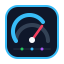

<div align="center">
  
  <h1>Antigravity Telemetry Monitor</h1>
  <p>
    <strong>面向 Google Antigravity IDE 与 OpenAI Codex 的实时模型路由、吐字速度（TPS）、KV 缓存与 5h/周配额监控面板</strong>
  </p>
  <p>
    <a href="./README.md">English</a> | <strong>简体中文</strong>
  </p>
  <p>
    
    
    
  </p>
</div>

---

**Antigravity Telemetry Monitor**（`agy-telemetry`）是一个轻量、零外部依赖的 Antigravity IDE 监控插件与侧边栏仪表盘（Sidecar HUD）。它帮你把 Agent 运行时的底层黑盒全部透明化：实际响应模型、真实流式吐字速度（Token/s）、首字延迟（TTFT）、KV Cache 命中率与实际缓存大小（`k`）、每轮任务的独立 Token 与 5 小时 / 周配额消耗、后台命令管控以及 Codex 协同进度。

## ✨ 核心功能

### 1. 全局并行监控与「最近活跃」智能排序
- **最近活跃视图**：默认展示所有**正在进行中**的任务（自动置顶）以及**今日未归档的主对话**，不被已结束的子代理（Subagent）和陈旧历史刷屏。
- **分类筛选与一键跳转**：支持在「最近活跃」「Codex」「全部」之间切换，一键跳转定位到对应 Antigravity 对话或 Codex Desktop 会话。
- **后台任务与常驻服务管控**：内联展示后台命令与常驻服务，支持实时耗时、流式日志尾行查看、一键复制启动命令及立即终止任务。

### 2. 本轮 / 末轮任务 vs. 会话全局平均（速度 & 缓存）
- **双口径对比**：外层卡片与详情面板同时呈现**当前/最近一轮**表现与**整个会话全局平均**数据：
  - **纯流式吐字速度（Streaming TPS）**：`outputTokens / streamingDuration`（剔除首字等待与缓冲刷出后的真实吐字速率）。
  - **端到端速度（E2E TPS）**：`outputTokens / (TTFT + streamingDuration)`。
  - **KV Cache 命中率与实际大小（`k`）**：同时展示命中百分比和实际缓存读取量（例如 `94.5% (859.7k)`）。

### 3. 历史轮次持久化与独立 Token / 配额消耗统计
- **就地手风琴展开**：点击任意会话卡片，直接在被点击卡片正下方展开详情（单开手风琴模式），1.5s 自动刷新时保留当前展开项与列表滚动位置。
- **按轮次任务列表保存**：以每次用户输入为一轮任务边界聚合底层多次 LLM 调用（Antigravity 依据 `USER_INPUT`，Codex 依据 `task_started`），并增量持久化到本地 `telemetry_task_history.json`。
- **全口径 Token 明细**：每轮独立统计总 Token（未命中输入 + 缓存读取 + 输出），展开单轮可下钻查看每次底层 LLM API 调用细节。
- **5 小时 + 周配额消耗追踪**：
  - **Antigravity**：联合读取 `RetrieveUserQuotaSummary` 与 `GetCascadeModelConfigData`，并内置 4 秒后台采样器，即使未打开面板也能持续捕获每轮起止的配额降幅；同池并发时按并发期间 Token 权重近似分摊并标 `~` 提示。
  - **Codex**：自动解析 rollout JSONL 日志中的原生 `rate_limits`，可自动回填每轮 5h 与周配额消耗。

### 4. 模型路由校验、签名头基线与异常诊断
- **路由一致性校验**：比对请求档位、后端返回 `responseModel` 与执行器模型 `executionModel`。
- **Thinking 签名协议头档案**：本地解析并记录各模型家族 Thinking 签名协议头前缀，发生未确认变更时高亮提醒。
- **重试与退化诊断**：区分上游 `429` 限流重试与本地网络/代理 EOF 重连，识别净排队延迟、思考链占比骤降与长上下文破缓存。

### 5. OpenAI Codex Desktop / CLI 协同监控
- 实时读取本地 `~/.codex` SQLite 与 rollout 日志，支持独立 Codex 任务卡片及 Antigravity 委派 Codex 执行时的协同进度托盘。

---

## 📦 安装方法

### 环境要求
- **Google Antigravity IDE**
- **Node.js `>= 22.0.0`**（需使用内置 `node:sqlite` 模块）

### 从 GitHub 安装

将仓库克隆到 Antigravity 插件目录（目录名保持为 `agy-telemetry`）：

**Windows (PowerShell):**
```powershell
git clone https://github.com/sLokya/antigravity-telemetry-monitor.git "$env:USERPROFILE\.gemini\config\plugins\agy-telemetry"
```

**macOS / Linux:**
```bash
git clone https://github.com/sLokya/antigravity-telemetry-monitor.git ~/.gemini/config/plugins/agy-telemetry
```

随后在 Antigravity 的 **Customizations → Plugins** 中启用 **Antigravity Telemetry — Model, Speed & Quota Monitor**，或直接对 Agent 说“打开 Telemetry HUD”即可使用。

---

## 🚀 使用方式

1. 从 Antigravity 侧边栏 / 辅助窗格打开 `Telemetry HUD`，或在对话中让 Agent 唤出面板。
2. 点击任意会话卡片即可在**卡片正下方就地展开**当前轮指标、路由诊断与历史轮次任务列表。
3. 点击历史任务列表中的任意一轮，可继续展开该轮内部的逐次 LLM 调用明细表。

---

## 🏗 目录结构

```text
agy-telemetry/
├── plugin.json                        # 插件清单与元信息
├── hooks.json                         # 生命周期 Hook 配置
├── assets/
│   └── logo.svg                       # 插件图标
├── skills/
│   └── telemetry/
│       └── SKILL.md                   # Agent 呼出与指标汇报技能
└── sidecars/
    └── monitor/
        ├── sidecar.json               # Sidecar 入口与视图配置
        ├── hook_tracker.mjs           # Hook 实时状态写入脚本
        ├── server.mjs                 # Sidecar 服务、LS RPC 与 Codex 监控主程序
        ├── fingerprint_ledger.mjs     # Thinking 签名头基线监测模块
        ├── turn_aggregator.mjs        # 按用户轮次聚合与速度/缓存指标计算
        ├── task_history_store.mjs     # 历史任务持久化与 5h/周配额降幅归因
        ├── index.html                 # HUD 主框架与全局概览
        ├── ui_fleet_cards.js          # 会话卡片、筛选与进行中置顶渲染
        └── ui_inline_detail.js        # 就地手风琴详情与轮次/调用下钻渲染
```

---

## 🔒 隐私与本地数据说明

所有监控逻辑均 **100% 本地运行**，仅与本机 Antigravity Language Server（`ANTIGRAVITY_LS_ADDRESS`）及本地 `~/.codex` 文件交互，不会向任何第三方服务器上传数据。

运行期状态文件保存在插件目录之外的 `~/.gemini/antigravity/scratch/`：
- `telemetry_live_state.json` — 最新 Hook 生命周期状态
- `telemetry_fingerprints.json` — 本地模型签名协议头基线档案
- `telemetry_task_history.json` — 本地保存的轮次任务与配额消耗记录

---

## 📄 开源协议

[MIT](./LICENSE)
